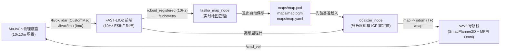
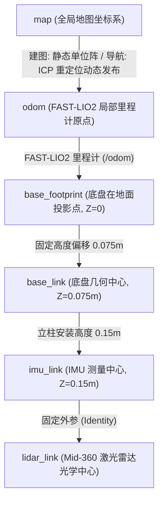

# slam_simulation

[](LICENSE)
[](https://docs.ros.org/en/humble/)
[](https://mujoco.org/)
[](https://github.com/hku-mars/FAST_LIO)

基于 **ROS 2 Humble** 与 **MuJoCo 物理引擎** 的大疆 Livox Mid-360 麦克纳姆轮全向底盘建图与自主导航完整方案。包含物理级仿真底盘、纯 FAST-LIO2 高频激光惯性里程计、先验 PCD 点云多角度粗精 ICP 重定位、Nav2（SmacPlanner2D + MPPI Omni）全向避障导航与交互式 3D PCD 点云查看器。

---

## 目录
- [1. Overview (系统架构与设计)](#1-overview)
  - [1.1 核心架构与功能](#11-核心架构与功能)
  - [1.2 坐标变换体系 (TF Tree)](#12-坐标变换体系-tf-tree)
  - [1.3 激光雷达视场角与盲区设计](#13-激光雷达视场角与盲区设计)
  - [1.4 路径规划与全向控制](#14-路径规划与全向控制)
  - [1.5 仓库文件结构](#15-仓库文件结构)
- [2. Quick Start (快速上手)](#2-quick-start)
  - [2.1 环境要求 (Setup Environment)](#21-环境要求-setup-environment)
  - [2.2 获取源码 (Create Workspace)](#22-获取源码-create-workspace)
  - [2.3 一键构建 (Build)](#23-一键构建-build)
  - [2.4 运行操作 (Running)](#24-运行操作-running)
    - [2.4.1 仿真运行模式](#241-仿真运行模式)
    - [2.4.2 全向键盘遥控操作](#242-全向键盘遥控操作)
    - [2.4.3 自动化测试与辅助工具](#243-自动化测试与辅助工具)
- [3. Launch & Script Arguments (完整参数字典)](#3-launch--script-arguments)
  - [3.1 建图脚本参数 (`mapping.sh`)](#31-建图脚本参数-mappingsh)
  - [3.2 导航脚本参数 (`navigation.sh`)](#32-导航脚本参数-navigationsh)
  - [3.3 手动重定位脚本参数 (`relocalize.sh`)](#33-手动重定位脚本参数-relocalizesh)
  - [3.4 点云查看器参数 (`view_pcd.sh`)](#34-点云查看器参数-view_pcdsh)
  - [3.5 离线栅格转换参数 (`pcd_to_grid.py`)](#35-离线栅格转换参数-pcd_to_gridpy)
  - [3.6 键盘遥控参数 (`teleop.sh`)](#36-键盘遥控参数-teleopsh)
- [4. Third-Party Code & Licensing (第三方开源依赖)](#4-third-party-code--licensing)
- [5. Troubleshooting & FAQ (补充调试指南)](#5-troubleshooting--faq)

---

## 1. Overview



### 1.1 核心架构与功能
1. **物理动力学仿真**：MuJoCo 仿真底盘包含四轮麦克纳姆轮等效辊子切向力动力学模型与真实滑动摩擦阻尼，激光雷达采用大疆官方非重复扫描线矩阵（24,000 点/帧序列）进行实时光束投射；
2. **纯 FAST-LIO2 建图**：采用 FAST-LIO2 的 10 Hz 高频配准输出；
3. **闭环地图自动持久化**：建图进程退出时自动将内存点云导出为 `maps/map.pcd`，并自动调用坡度/阶梯地面地形分类算法输出 2D 占据栅格地图 `maps/map.pgm` 与 `maps/map.yaml`；
4. **先验地图全局重定位**：导航时通过先验 PCD 进行全局多角度粗匹配与精细 ICP 对齐，实时更新 `map -> odom` 坐标漂移；
5. **全向运动规划**：Nav2 配备 SmacPlanner2D 全局规划器与 MPPI Omni 局部控制器，支持机器人任意方向平移与边走边转。

---

### 1.2 坐标变换体系 (TF Tree)

本项目严格规范了传感器系、机器人本体系、里程计系与全局地图系之间的坐标变换逻辑：



- **建图模式**：`fastlio_map_node` 广播静态变换 `map -> odom`，`bridge_node` 根据 FAST-LIO2 状态发布 `odom -> base_footprint` 与 `base_link`；
- **导航模式**：`localizer_node` 通过 ICP 算法计算小车当前在先验地图中的绝对位姿，动态高频修正并发布 `map -> odom` TF，消除长距离累积漂移。

---

### 1.3 激光雷达视场角

Livox Mid-360 采用独特的非重复环形扫描结构：
- **水平视场 (Horizontal FOV)**： 360度 全方位无盲区
- **垂直天顶角 (Zenith Angle)**：-7～52度（59度）

---

### 1.4 路径规划与全向控制

- **全局路径规划 (Global Planner)**：采用 Nav2 的 `SmacPlanner2D`，支持在连续空间中快速搜索平滑、无碰撞的最优路径；
- **局部轨迹跟踪 (Local Controller)**：采用 `MPPI Omni`（Model Predictive Path Integral 控制器），原生针对四轮麦克纳姆轮的全向速度自由度 $(v_x, v_y, \omega_z)$ 进行采样优化，无需像阿克曼或差速底盘那样先对准车头再前进，支持直行、横移与旋转同步合成。

---

### 1.5 仓库文件结构

```plaintext
.
├── .deps/                          # 本地编译安装的 Livox-SDK2 底层 C++ 库
├── .venv/                          # 项目专属 Python 虚拟环境 (带 mujoco, open3d 等)
├── artifacts/                      # 运行日志备份、轨迹指标与仿真快照
├── maps/                           # 标准持久化地图目录 (map.pcd, map.pgm, map.yaml)
├── patches/                        # 开源库适配补丁 (fast_lio_ros2.patch)
├── requirements.txt                # Python 依赖清单
├── scripts/                        # 核心运行脚本目录
│   ├── build.sh                    # 一键环境配置与编译脚本
│   ├── env.sh                      # 环境变量加载脚本
│   ├── mapping.sh                  # 纯 FAST-LIO2 建图脚本
│   ├── navigation.sh               # 先验地图 ICP 重定位与自主导航脚本
│   ├── relocalize.sh               # 独立手动重定位演示脚本 (非原点出生与错位吸附)
│   ├── teleop.sh                   # 麦轮全向键盘控制启动脚本
│   ├── teleop_keyboard.py          # 键盘控制核心逻辑
│   ├── view_pcd.sh                 # 3D PCD 点云交互式查看器启动脚本
│   ├── view_pcd.py                 # 点云查看器核心逻辑 (Open3D)
│   ├── pcd_to_grid.py              # 离线 3D PCD 转 2D 占据栅格地图工具
│   ├── omni_navigation.sh          # 在线边建图边导航模式
│   └── test_navigation.sh          # 无界面自动化导航验收脚本
├── src/                            # ROS 2 源码功能包
│   ├── FAST_LIO/                   # FAST-LIO2 激光惯导里程计算法
│   ├── livox_ros_driver2/          # 大疆 Livox ROS 2 官方驱动与消息
│   └── nav_stack/                  # 集成调度、MuJoCo仿真底盘、地形分类与导航配置
├── tests/                          # 物理仿真与功能单元测试
└── third_party/                    # 第三方依赖与 SDK (Livox-SDK2 等)
```

---

## 2. Quick Start

### 2.1 环境要求 (Setup Environment)
- **操作系统**：Ubuntu 22.04 LTS (x86_64)
- **ROS 版本**：[ROS 2 Humble](https://docs.ros.org/en/humble/Installation/Ubuntu-Install-Debians.html) (Desktop 桌面版)
- **Python 版本**：Python 3.10+
- **安装系统与 ROS 2 依赖**：
  在终端中运行以下命令安装 C++ 编译工具链、PCL 点云开发库以及 Nav2 导航栈等依赖项：
  ```bash
  sudo apt update && sudo apt install -y \
    build-essential cmake git python3-colcon-common-extensions \
    python3-venv python3-pip libeigen3-dev libpcl-dev pcl-tools \
    libgl1 libglfw3 ros-humble-desktop ros-humble-navigation2 \
    ros-humble-nav2-bringup ros-humble-pcl-ros ros-humble-pcl-conversions \
    ros-humble-sensor-msgs-py ros-humble-tf2-ros-py
  ```

### 2.2 获取源码 (Create Workspace)
创建工作空间目录并克隆项目源码：

```bash
# 创建并进入工作目录（例如 ~/ros_ws）
mkdir -p ~/ros_ws
cd ~/ros_ws

# 克隆仓库并进入项目主目录
git clone https://github.com/WrenInk/slam_simulation.git
cd slam_simulation
```

> [!NOTE]
> - **先验点云与地图**：本项目已在 `maps/` 目录下内置了默认仿真场景的先验点云与 2D 占据栅格地图（`map.pcd`、`map.pgm` 与 `map.yaml`），开箱即用，无需额外前往网盘下载即可直接开启导航。
> - **第三方算法与驱动**：本仓库已内置适配好的 FAST-LIO2、Livox-SDK2 与大疆官方驱动源码，克隆后无需额外递归拉取子模块或手动打补丁。

### 2.3 一键构建 (Build)
赋予脚本执行权限并运行项目内置的一键编译脚本：

```bash
chmod +x scripts/*.sh
./scripts/build.sh
```

构建脚本会自动完成：
1. 创建专属的 Python 隔离虚拟环境（`.venv/`），并安装所需的科学计算依赖（`mujoco==3.3.7`, `open3d==0.19.0`, `gtsam==4.2` 等）；
2. 编译并本地安装 C++ `Livox-SDK2` 驱动库至 `.deps/`；
3. 执行 `colcon build --symlink-install` 编译 ROS 2 核心功能包（`FAST_LIO`, `livox_ros_driver2`, `nav_stack`）；
4. 自动执行单元测试验证物理动力学与传感器链路。

> [!NOTE]
> 推荐使用 `--symlink-install` 选项来构建你的工作空间（`./scripts/build.sh` 脚本已内置该选项），因为 `slam_simulation` 广泛使用了 `launch.py` 文件和 YAML 配置文件。这个构建参数会为那些非编译的源文件使用符号链接，这意味着当你调整参数文件时，不需要反复重建，只需要重新启动即可。

---

### 2.4 运行操作 (Running)

可使用以下命令启动，在 RViz 中使用 `Nav2 Goal` 插件发布目标点。
所有启动脚本均已内置环境加载逻辑（自动导入 ROS 2 与本地工作空间配置）。

#### 2.4.1 仿真运行模式

**单机器人：**

- **建图模式 (Mapping Mode)**：
  - **终端 1 启动仿真底盘与 FAST-LIO2 建图**：
    ```bash
    ./scripts/mapping.sh
    # 或使用 ROS 2 Launch 格式：
    # ros2 launch nav_stack mapping.launch.py
    ```
    自动启动 MuJoCo 仿真底盘、纯 FAST-LIO2 算法（10 Hz 高频配准）、实时地图管理节点与 RViz2（青色为实时扫描点云，彩色为全局累积地图）。
  - **终端 2 启动全向键盘遥控**：
    
    ```bash
    ./scripts/teleop.sh
    ```
  - **保存栅格与点云地图**：
    在终端 1 按 `Ctrl + C` 退出建图，系统将自动将当前全局点云写入 `maps/map.pcd`，同时自动转换为 2D 占据栅格地图 `maps/map.pgm` 与 `maps/map.yaml`。
    *(亦可随时使用 Nav2 命令行手动保存：`ros2 run nav2_map_server map_saver_cli -f maps/<YOUR_MAP_NAME>`)*
  
- **导航模式 (Navigation Mode)**：
  
  - **终端启动先验地图 ICP 重定位与 Nav2 自主导航**：
    ```bash
    ./scripts/navigation.sh
    # 或使用 ROS 2 Launch 格式：
    # ros2 launch nav_stack navigation.launch.py map:=maps/map.yaml pcd:=maps/map.pcd
    ```
    等待终端提示 `Navigation: active` 并在 RViz 中看到先验点云与栅格地图后，点击 RViz 顶栏的 **`Nav2 Goal`** 并在地图可行走区域点击拖出目标位姿箭头，全向麦轮底盘即可平滑避障抵达目标。

#### 2.4.2 全向键盘遥控操作

专门针对四轮麦克纳姆轮底盘设计的全向控制程序：

```bash
./scripts/teleop.sh
```

| 按键 | 功能说明 | 控制效果 |
| :---: | :--- | :--- |
| **`W` / `S`** | 纵向平移 | 前进 / 后退 |
| **`A` / `D`** | 横向平移 | 向左横移 / 向右横移（麦轮全向平移） |
| **`Q` / `E`** | 航向旋转 | 原地逆时针旋转 / 原地顺时针旋转 |
| **`Space`** 或 **`K`** | 急停刹车 | 底盘平移与自转速度瞬间归零 |
| **`1` / `2` / `3`** | 速度挡位 | 切换 低速 (0.15 m/s)、中速 (0.30 m/s)、高速 (0.45 m/s) |
| **`U` / `J`** | 微调线速度 | 每次增减 10% 速度上限 |
| **`I` / `M`** | 微调角速度 | 每次增减 10% 转向角速度 |
| **`Tab`** | 模式切换 | 在**按住保持模式**（松开停车）与**巡航锁定模式**（松手保持当前速度）之间切换 |

#### 2.4.3 自动化测试与辅助工具

- **自动化无头导航验收 (Headless Test)**：
  ```bash
  ./scripts/test_navigation.sh
  ```
  适用于 CI 环境或无显示器服务器，后台静默启动物理仿真、FAST-LIO2、ICP 重定位与 Nav2 航点到达闭环验证。

- **手动重定位演示模式 (Manual Relocalization Demo)**：
  ```bash
  ./scripts/relocalize.sh
  ```
  测试底盘在除原点外的任意位置启动时的错位状态，并通过 RViz 的 `2D Pose Estimate` 工具手动下发粗位姿，验证粗精 ICP 瞬时对齐吸附至真实位姿。

- **交互式 3D PCD 点云查看器 (PCD Viewer)**：
  ```bash
  # 查看默认建图结果 maps/map.pcd
  ./scripts/view_pcd.sh
  
  # 查看指定路径的 PCD 点云
  ./scripts/view_pcd.sh path/to/any_map.pcd
  ```
  基于 Open3D 构建，支持高程伪彩着色、世界坐标轴、点云尺寸统计与鼠标旋转缩放漫游。

- **离线 PCD 转 2D 栅格地图工具 (PCD to Grid)**：
  ```bash
  python3 scripts/pcd_to_grid.py --pcd maps/map.pcd --resolution 0.05
  ```
  脱离 ROS 节点将任意 PCD 点云快速转换为 Nav2 占据栅格地图（`.pgm` 与 `.yaml`）。

---

## 3. Launch & Script Arguments

所有带参数的运行脚本均遵循标准的参数规范。以下为详尽参数速查字典：

### 3.1 建图脚本参数 (`mapping.sh`)

**指令语法**：
```bash
./scripts/mapping.sh [gui:=true/false] [rviz:=true/false] [realtime_factor:=<数值>] [map_save_dir:=<路径>] [output_dir:=<路径>]
```

| 参数名 | 类型 | 默认值 | 作用说明 | `true`/`false` 或数值大小含义 |
| :--- | :---: | :---: | :--- | :--- |
| **`gui`** | bool | `true` | 是否启动 MuJoCo 仿真物理窗口 | • **`true`**：打开 3D 渲染窗口，观察真实动力学与碰撞。<br>• **`false`**：纯后台静默运行物理推演，大幅节省 CPU 与 GPU。 |
| **`rviz`** | bool | `true` | 是否启动 RViz2 界面 | • **`true`**：启动 RViz2 观察实时点云与全局地图。<br>• **`false`**：关闭 RViz2 界面（适合远程 SSH 跑图）。 |
| **`realtime_factor`** | float | `1.0` | 仿真时间流逝倍率 | • **`= 1.0`**：原速真实时间。<br>• **`> 1.0`**（如 `2.0`）：**加速仿真**，缩短建图时间。<br>• **`< 1.0`**（如 `0.5`）：**减速慢动作**，防止低配机器丢步。 |
| **`map_save_dir`** | string | `maps` | 地图自动导出目录 | 建图结束按 `Ctrl+C` 时，生成的 `map.pcd`、`map.pgm`、`map.yaml` 存放的文件夹路径。 |
| **`output_dir`** | string | `artifacts/mapping` | 运行日志与轨迹备份目录 | 存放当次运行的评估指标（`metrics.json`）与 TUM 轨迹文件备份。 |

---

### 3.2 导航脚本参数 (`navigation.sh`)

**指令语法**：
```bash
./scripts/navigation.sh [initial_pose_x:=<数值>] [initial_pose_y:=<数值>] [initial_pose_yaw:=<数值>] [gui:=true/false] [rviz:=true/false] [map_pcd:=<路径>] [map_yaml:=<路径>] [realtime_factor:=<数值>]
```

| 参数名 | 类型 | 默认值 | 作用说明 | `true`/`false` 或数值大小含义 |
| :--- | :---: | :---: | :--- | :--- |
| **`initial_pose_x`** | float | `0.0` | 机器人初始估计在地图中的 X 坐标（米） | **先验地图全局坐标**（米）。默认 `0.0`（建图起点/原位）；若底盘在其他位置启动，需指定大致初值以便 ICP 快速收敛。 |
| **`initial_pose_y`** | float | `0.0` | 机器人初始估计在地图中的 Y 坐标（米） | 先验地图全局坐标 Y（米）。默认 `0.0`（建图起点/原位）。 |
| **`initial_pose_yaw`**| float | `0.0` | 机器人初始估计航向角（弧度） | 弧度值。 |
| **`gui`** | bool | `true` | 是否开启 MuJoCo 物理窗口 | • **`true`**：开启仿真三维视图；<br>• **`false`**：后台纯动力学推演。 |
| **`rviz`** | bool | `true` | 是否开启 RViz2 导航操作界面 | • **`true`**：打开 RViz2（含 `Nav2 Goal` 控制面板）；<br>• **`false`**：关闭图形界面。 |
| **`map_pcd`** | string | `maps/map.pcd` | 先验 3D PCD 点云文件路径 | ICP 全局重定位匹配的环境三维点云基准。 |
| **`map_yaml`** | string | `maps/map.yaml` | 2D 占据栅格地图配置文件路径 | Nav2 代价地图用于全局规划和避障膨胀的栅格地图。 |
| **`realtime_factor`** | float | `1.0` | 仿真运行速率倍数 | • **`> 1.0`** 加速仿真，• **`< 1.0`** 减速仿真。 |

---

### 3.3 手动重定位脚本参数 (`relocalize.sh`)

**指令语法**：
```bash
./scripts/relocalize.sh [spawn_x:=<数值>] [spawn_y:=<数值>] [spawn_yaw:=<数值>] [gui:=true/false] [rviz:=true/false] [map_pcd:=<路径>] [map_yaml:=<路径>] [realtime_factor:=<数值>]
```

| 参数名 | 类型 | 默认值 | 作用说明 | `true`/`false` 或数值大小含义 |
| :--- | :---: | :---: | :--- | :--- |
| **`spawn_x`** | float | `-2.0` | 仿真物理出生点 X 坐标（米） | 远离原点的自定义出生点，默认处于场地开阔区。 |
| **`spawn_y`** | float | `0.0` | 仿真物理出生点 Y 坐标（米） | 物理出生点 Y 坐标。 |
| **`spawn_yaw`** | float | `0.523` | 仿真初始朝向偏航角（弧度） | 默认约 $30^\circ$ 航向角。 |
| **`gui`** | bool | `true` | 是否开启 MuJoCo 物理窗口 | • **`true`**：开启仿真三维视图；• **`false`**：后台纯动力学推演。 |
| **`rviz`** | bool | `true` | 是否开启 RViz2 重定位界面 | • **`true`**：开启专属精简 RViz（仅含实时点云、栅格地图与 `2D Pose Estimate` 工具）。 |
| **`map_pcd`** | string | `maps/map.pcd` | 先验 3D PCD 点云文件路径 | ICP 全局重定位匹配的环境三维点云基准。 |
| **`map_yaml`** | string | `maps/map.yaml` | 2D 占据栅格地图配置文件路径 | 视觉对比的 2D 静态栅格地图。 |
| **`realtime_factor`** | float | `1.0` | 仿真运行速率倍数 | • **`> 1.0`** 加速仿真，• **`< 1.0`** 减速仿真。 |

---

### 3.4 点云查看器参数 (`view_pcd.sh`)

**指令语法**：
```bash
./scripts/view_pcd.sh [pcd路径] [--backend {open3d,pcl}] [--color {elevation,turbo,viridis,jet,uniform}] [--point-size <数值>] [--voxel-size <数值>] [--no-axes]
```

| 参数名 | 默认值 | 作用说明 | 选项或数值大小含义 |
| :--- | :---: | :--- | :--- |
| **`pcd`** *(位置参数)* | `maps/map.pcd` | 待查看的 PCD 文件路径 | 传入需要可视化的点云路径（省略则自动寻找并加载默认地图）。 |
| **`--backend`** | `open3d` | 3D 渲染底层后端引擎 | • **`open3d`**：现代 GPU 着色高亮伪彩查看器。<br>• **`pcl`**：系统原生 `pcl_viewer`（备用后端）。 |
| **`--color`** | `elevation` | 点云伪彩色带渲染模式 | • **`elevation` / `turbo`**：根据 Z 轴高度渐变伪彩（蓝-绿-黄-红）。<br>• **`viridis`**：高对比翠绿-紫蓝科研色带。<br>• **`jet`**：经典彩虹色带。<br>• **`uniform`**：纯浅蓝单色显示。 |
| **`--point-size`** | `3.0` | 点粒子渲染直径大小 | • **数值越大**（如 `5.0`）：点越大，适合远景或稀疏点云观察。<br>• **数值越小**（如 `1.0`）：点越细腻，适合近距离细致结构观察。 |
| **`--voxel-size`** | `None` | 实时体素网格滤波降采样（米） | • **数值大小**：例如 `0.05`，将 5cm 空间内的点合并为 1 个体素点，点云极大时可显著提高渲染流畅度。 |
| **`--no-axes`** | *(带坐标轴)* | 隐藏世界原点坐标轴标记 | 添加此参数将隐藏原点处的红绿蓝坐标轴（$X$红、$Y$绿、$Z$蓝）。 |

---

### 3.5 离线栅格转换参数 (`pcd_to_grid.py`)

**指令语法**：
```bash
python3 scripts/pcd_to_grid.py [--pcd <路径>] [--output-dir <路径>] [--resolution <数值>] [--name <名称>] [--occupied-thresh <数值>] [--free-thresh <数值>]
```

| 参数名 | 默认值 | 作用说明 | 数值大小物理含义 |
| :--- | :---: | :--- | :--- |
| **`--pcd`** | `maps/map.pcd` | 输入的源 PCD 点云文件 | 指定待转换的三维点云源路径。 |
| **`--output-dir`** | 与 PCD 相同 | 输出文件存放文件夹 | 生成的 `.pgm` 与 `.yaml` 保存路径。 |
| **`--resolution`** | `0.05` | 栅格地图分辨率（米/像素） | **每个像素代表的物理距离**：<br>• **数值越小**（如 `0.02`）：地图越精细，但图像像素数大、内存与规划开销上升。<br>• **数值越大**（如 `0.10`）：地图越粗糙，但 Nav2 全局寻路计算更快。 |
| **`--name`** | `map` | 导出的地图文件前缀 | 自定义输出文件名（如指定 `arena` 则生成 `arena.pgm` 和 `arena.yaml`）。 |
| **`--occupied-thresh`** | `0.65` | 障碍物判定概率阈值 ($0\sim1$) | **判断为墙壁/障碍物的门限**：<br>• 概率**高于此值**标记为黑色（数值 0，不可通行障碍物）。<br>• **数值调小**（如 `0.50`）：更保守，细小凸起物均判定为障碍。<br>• **数值调大**（如 `0.80`）：滤除地面噪点，避免微小碎点阻挡规划。 |
| **`--free-thresh`** | `0.25` | 安全空闲判定概率阈值 ($0\sim1$) | **判断为平坦可通行的门限**：<br>• 概率**低于此值**标记为白色（数值 254，完全可行走地面）。<br>• 处于两阈值之间标记为灰色未知区域（数值 205）。 |

---

### 3.6 键盘遥控参数 (`teleop.sh`)

**指令语法**：

```bash
./scripts/teleop.sh [--ros-args -p default_gear:=<1/2/3>]
```

| 参数名 | 默认值 | 作用说明 | 选项与数值大小含义 |
| :--- | :---: | :--- | :--- |
| **`default_gear`** | `2` | 启动时的默认移动速度挡位 | • **`1`（低速）**：线速度 $0.15\text{ m/s}$，角速度 $0.30\text{ rad/s}$。<br>• **`2`（中速）**：线速度 $0.30\text{ m/s}$，角速度 $0.60\text{ rad/s}$。<br>• **`3`（高速）**：线速度 $0.45\text{ m/s}$，角速度 $0.80\text{ rad/s}$。 |

---

## 4. Third-Party Code & Licensing

本项目严格遵循开源许可规范，所有开源软件与源码引用说明如下（详见 [`THIRD_PARTY.md`](file:///home/xiaocheng/slam_study/THIRD_PARTY.md)）：

1. **FAST-LIO2** (GPL-2.0)：香港大学 MARS 实验室开源算法，针对 ROS 2 Humble 进行了深度兼容适配（见 [`patches/fast_lio_ros2.patch`](file:///home/xiaocheng/slam_study/patches/fast_lio_ros2.patch)）；
2. **Livox-SDK2 与 livox_ros_driver2** (Apache-2.0 / BSD)：大疆官方驱动与通讯库，已内置于本地编译安装，无需系统级安装；
3. **LIO-SAM 算法衍生** (BSD-3-Clause)：算法参考用于 [`pose_graph.py`](file:///home/xiaocheng/slam_study/src/nav_stack/nav_stack/pose_graph.py)，保留为备用因子图模块；
4. **Nav2 (Navigation 2)** (Apache-2.0)：官方自主导航框架，使用 SmacPlanner2D 与 MPPI Omni 控制器；
5. **MuJoCo** (Apache-2.0)：Google DeepMind 开源物理引擎，负责麦轮牵引力与非重复激光射线扫描仿真。

