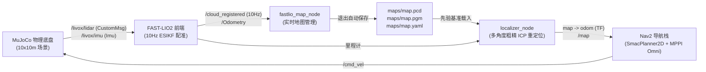
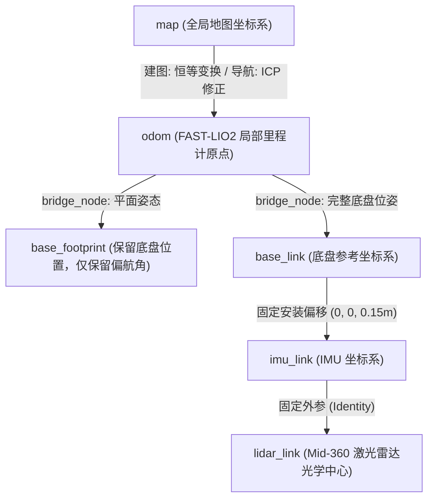

# slam_simulation

[](LICENSE)
[](https://docs.ros.org/en/humble/)
[](https://mujoco.org/)
[](https://github.com/hku-mars/FAST_LIO)

基于 **ROS 2 Humble** 与 **MuJoCo 物理引擎** 的 Livox Mid-360 麦克纳姆轮全向底盘建图与自主导航项目。包含物理仿真底盘、FAST-LIO2 激光惯性里程计、先验 PCD 点云多角度粗精 ICP 重定位、Nav2（SmacPlanner2D + MPPI Omni）全向避障导航与交互式 3D PCD 点云查看器。

---

## 目录
- [1. Overview (系统架构与设计)](#1-overview)
  - [1.1 核心架构与功能](#11-核心架构与功能)
  - [1.2 坐标变换体系 (TF Tree)](#12-坐标变换体系-tf-tree)
  - [1.3 激光雷达视场角](#13-激光雷达视场角)
  - [1.4 路径规划与全向控制](#14-路径规划与全向控制)
  - [1.5 仓库文件结构](#15-仓库文件结构)
- [2. Quick Start (快速上手)](#2-quick-start)
  - [2.1 环境要求 (Setup Environment)](#21-环境要求-setup-environment)
  - [2.2 获取源码 (Create Workspace)](#22-获取源码-create-workspace)
  - [2.3 一键构建 (Build)](#23-一键构建-build)
  - [2.4 运行操作 (Running)](#24-运行操作-running)
    - [2.4.1 仿真运行模式](#241-仿真运行模式)
    - [2.4.2 全向键盘遥控操作](#242-全向键盘遥控操作)
    - [2.4.3 自动化测试与辅助工具](#243-自动化测试与辅助工具)
- [3. Launch & Script Arguments (完整参数字典)](#3-launch--script-arguments)
  - [3.1 建图脚本参数 (`mapping.sh`)](#31-建图脚本参数-mappingsh)
  - [3.2 导航脚本参数 (`navigation.sh`)](#32-导航脚本参数-navigationsh)
  - [3.3 手动重定位脚本参数 (`relocalize.sh`)](#33-手动重定位脚本参数-relocalizesh)
  - [3.4 点云查看器参数 (`view_pcd.sh`)](#34-点云查看器参数-view_pcdsh)
  - [3.5 离线栅格转换参数 (`pcd_to_grid.py`)](#35-离线栅格转换参数-pcd_to_gridpy)
  - [3.6 键盘遥控速度挡位 (`teleop.sh`)](#36-键盘遥控速度挡位-teleopsh)
- [4. Third-Party Code & Licensing (第三方开源依赖)](#4-third-party-code--licensing)

---

## 1. Overview



### 1.1 核心架构与功能

1. **物理动力学仿真**：MuJoCo 仿真底盘包含四轮麦克纳姆轮等效辊子切向力动力学模型与滑动摩擦阻尼。激光雷达复用第三方 Mid-360 扫描方向表，原始序列按 24,000 个采样位置分帧；当前启动配置每帧投射 12,000 条射线，有效返回点数还取决于遮挡和量程；
2. **FAST-LIO2 建图**：采用 10 Hz 雷达扫描驱动激光惯性配准，`fastlio_map_node` 累积配准后的点云；当前启动流程未启用回环检测或位姿图优化；
3. **地图自动持久化**：建图进程正常退出时将内存点云导出为 `maps/map.pcd`，并调用坡度/阶梯地面地形分类算法输出 2D 占据栅格地图 `maps/map.pgm` 与 `maps/map.yaml`；
4. **先验地图重定位**：导航时在初始位置估计附近尝试多个航向角，通过粗精 ICP 与先验 PCD 对齐，更新 `map -> odom`。匹配依赖初值、点云重合度与场景特征，不进行全地图位置遍历；
5. **全向运动规划**：Nav2 配备 SmacPlanner2D 全局规划器与 MPPI Omni 局部控制器，支持机器人任意方向平移与边走边转。

---

### 1.2 坐标变换体系 (TF Tree)

主要坐标系关系如下，箭头表示父坐标系到子坐标系的变换：



- **建图模式**：`fastlio_map_node` 在初始化时静态发布恒等变换 `map -> odom`，之后周期性动态刷新同一变换；在线建图导航模式也使用这个关系。
- **已有地图导航与重定位模式**：`localizer_node` 根据 ICP 匹配结果更新 `map -> odom`，以 20 Hz 发布 TF。匹配成功时可修正里程计相对先验地图的偏差。
- **底盘位姿**：FAST-LIO2 发布 `/Odometry` 消息，`bridge_node` 将 IMU 位姿换算成底盘位姿，再分别发布 `odom -> base_link` 和 `odom -> base_footprint`。两者位置 xyz 相同；后者只保留偏航角，不强制将 z 设为零。`/odom` 是给导航使用的里程计话题。
- **机器人内部关系**：[`omni_mid360.urdf`](src/nav_stack/urdf/omni_mid360.urdf) 定义底盘、支架、IMU、雷达和轮子的连接。`robot_state_publisher` 读取它，将固定连接发布到 `/tf_static`，结合 `/joint_states` 将轮子等可动连接发布到 `/tf`。
- **配置入口**：完整仿真使用 [`simulation.yaml`](src/nav_stack/config/simulation.yaml)，其中 `publish.tf_en: false` 关闭 FAST-LIO2 自身的 TF 广播，底盘关系由 `bridge_node` 统一发布。单独启动 FAST-LIO2 也须加载参数文件，`mapping.extrinsic_T` 和 `mapping.extrinsic_R` 分别需要 3 个和 9 个有限数值；无效参数会给出错误并终止启动。消息中的 `frame_id` 仅标明数据所属坐标系，不会自动建立 TF 连接。

---

### 1.3 激光雷达视场角

Livox Mid-360 采用独特的非重复环形扫描结构：
- **水平视场 (Horizontal FOV)**：360 度，实际观测仍受近距盲区与物体遮挡影响。
- **垂直视场 (Vertical FOV)**：相对水平面约 -7～52 度（59 度）。

---

### 1.4 路径规划与全向控制

- **全局路径规划 (Global Planner)**：采用 Nav2 的 `SmacPlanner2D`，在二维栅格代价地图中搜索路径，并进行平滑处理；
- **局部轨迹跟踪 (Local Controller)**：采用 `MPPI Omni`（Model Predictive Path Integral 控制器），原生针对四轮麦克纳姆轮的全向速度自由度 $(v_x, v_y, \omega_z)$ 进行采样优化，无需像阿克曼或差速底盘那样先对准车头再前进，支持直行、横移与旋转同步合成。

---

### 1.5 仓库文件结构

```plaintext
.
├── .deps/                          # 本地编译安装的 Livox-SDK2 底层 C++ 库
├── .venv/                          # 项目专属 Python 虚拟环境 (带 mujoco, open3d 等)
├── artifacts/                      # 运行日志备份、轨迹指标与仿真快照
├── maps/                           # 标准持久化地图目录 (map.pcd, map.pgm, map.yaml)
├── patches/                        # 开源库适配补丁 (fast_lio_ros2.patch)
├── requirements.txt                # Python 依赖清单
├── scripts/                        # 核心运行脚本目录
│   ├── build.sh                    # 一键环境配置与编译脚本
│   ├── env.sh                      # 环境变量加载脚本
│   ├── mapping.sh                  # 纯 FAST-LIO2 建图脚本
│   ├── navigation.sh               # 先验地图 ICP 重定位与自主导航脚本
│   ├── relocalize.sh               # 独立手动重定位演示脚本 (非原点出生与 ICP 匹配)
│   ├── prior_map_args.sh           # 导航与重定位共用的地图路径解析
│   ├── teleop.sh                   # 麦轮全向键盘控制启动脚本
│   ├── teleop_keyboard.py          # 键盘控制核心逻辑
│   ├── view_pcd.sh                 # 3D PCD 点云交互式查看器启动脚本
│   ├── view_pcd.py                 # 点云查看器核心逻辑 (Open3D)
│   ├── pcd_to_grid.py              # 离线 3D PCD 转 2D 占据栅格地图工具
│   ├── omni_navigation.sh          # 在线边建图边导航模式
│   └── test_navigation.sh          # 无界面自动化导航验收脚本
├── src/                            # ROS 2 源码功能包
│   ├── FAST_LIO/                   # FAST-LIO2 激光惯导里程计算法
│   ├── livox_ros_driver2/          # 大疆 Livox ROS 2 官方驱动与消息
│   └── nav_stack/                  # 集成调度、MuJoCo仿真底盘、地形分类与导航配置
├── tests/                          # 物理仿真与功能单元测试
└── third_party/                    # 第三方依赖与 SDK，由 COLCON_IGNORE 排除递归扫描
```

---

## 2. Quick Start

### 2.1 环境要求 (Setup Environment)
- **操作系统**：Ubuntu 22.04 LTS (x86_64)
- **ROS 版本**：[ROS 2 Humble](https://docs.ros.org/en/humble/Installation/Ubuntu-Install-Debians.html) (Desktop 桌面版)
- **Python 版本**：Ubuntu 22.04 系统 Python 3.10
- **安装系统与 ROS 2 依赖**：
  在终端中运行以下命令安装 C++ 编译工具链、PCL 点云开发库以及 Nav2 导航栈等依赖项：
  ```bash
  sudo apt update && sudo apt install -y \
    build-essential cmake git python3-colcon-common-extensions \
    python3-venv python3-pip libeigen3-dev libpcl-dev pcl-tools \
    libgl1 libglfw3 ros-humble-desktop ros-humble-navigation2 \
    ros-humble-nav2-bringup ros-humble-pcl-ros ros-humble-pcl-conversions \
    ros-humble-sensor-msgs-py ros-humble-tf2-ros-py
  ```

### 2.2 获取源码 (Create Workspace)
创建工作空间目录并克隆项目源码：

```bash
# 创建并进入工作目录（例如 ~/ros_ws）
mkdir -p ~/ros_ws
cd ~/ros_ws

# 克隆仓库并进入项目主目录
git clone https://github.com/WrenInk/slam_simulation.git
cd slam_simulation
```

> [!NOTE]
> - **先验点云与地图**：本项目已在 `maps/` 目录下内置了默认仿真场景的先验点云与 2D 占据栅格地图（`map.pcd`、`map.pgm` 与 `map.yaml`），开箱即用，无需额外前往网盘下载即可直接开启导航。
> - **第三方算法与驱动**：本仓库已内置适配好的 FAST-LIO2、Livox-SDK2 与大疆官方驱动源码，克隆后无需额外递归拉取子模块或手动打补丁。

### 2.3 一键构建 (Build)
赋予脚本执行权限并运行项目内置的一键编译脚本：

```bash
chmod +x scripts/*.sh
./scripts/build.sh
```

构建脚本会自动完成：
1. 使用系统 Python 创建项目虚拟环境（`.venv/`，可访问系统包），并安装所需的科学计算依赖（`mujoco==3.3.7`, `open3d==0.19.0`, `gtsam==4.2` 等）；
2. 编译并本地安装 C++ `Livox-SDK2` 驱动库至 `.deps/`；
3. 执行 `colcon build --base-paths src --symlink-install`，并传入 ROS 版本和 SDK 路径等参数，编译 ROS 2 核心功能包（`fast_lio`、`livox_ros_driver2`、`nav_stack`）；
4. 自动执行单元测试验证物理动力学与传感器链路。

`third_party/COLCON_IGNORE` 将 SDK 源码和旧 ROS 1 仿真参考包排除在 colcon 的递归扫描之外；SDK 由 `build.sh` 单独编译。首次构建使用上述脚本，以准备 Python 依赖和本地 SDK。

依赖准备完成后，可在仓库根目录增量编译：

```bash
source scripts/env.sh
colcon build --symlink-install
```

> [!NOTE]
> 推荐使用 `--symlink-install` 选项来构建你的工作空间（`./scripts/build.sh` 脚本已内置该选项），因为 `slam_simulation` 广泛使用了 `launch.py` 文件和 YAML 配置文件。这个构建参数会为那些非编译的源文件使用符号链接，这意味着当你调整参数文件时，不需要反复重建，只需要重新启动即可。

---

### 2.4 运行操作 (Running)

以下命令在仓库根目录执行。导航模式中可在 RViz 使用 `Nav2 Goal` 发布目标点。
各 `.sh` 启动脚本会自动加载 `scripts/env.sh`。在新终端直接执行 `ros2 launch`、`ros2 run` 或 Python 工具前，先执行：

```bash
source scripts/env.sh
```

该脚本加载 ROS 2 和 `install/setup.bash`，把 `.venv` 的 Python 包目录加入 `PYTHONPATH`，设置本地 SDK 动态库搜索路径及 ROS 通信环境。它不会激活虚拟环境或切换 Python 解释器，也无须再单独加载 `install/setup.bash`。执行 `./scripts/build.sh` 不会把脚本内部的环境设置保留到当前终端。

#### 2.4.1 仿真运行模式

**单机器人：**

- **建图模式 (Mapping Mode)**：
  - **终端 1 启动仿真底盘与 FAST-LIO2 建图**：
    ```bash
    ./scripts/mapping.sh
    # 或在新终端手动加载环境后启动：
    # source scripts/env.sh
    # ros2 launch nav_stack mapping.launch.py
    ```
    自动启动 MuJoCo 仿真底盘、FAST-LIO2（10 Hz 雷达扫描）、实时地图管理节点与 RViz2（青色为实时扫描点云，彩色为全局累积地图）。
  - **终端 2 启动全向键盘遥控**：
    
    ```bash
    ./scripts/teleop.sh
    ```
  - **保存栅格与点云地图**：
    在终端 1 按 `Ctrl + C` 退出建图，系统将自动将当前全局点云写入 `maps/map.pcd`，同时自动转换为 2D 占据栅格地图 `maps/map.pgm` 与 `maps/map.yaml`。
    若要在运行中保存点云与栅格，可在已加载环境的另一个终端执行 `ros2 service call /slam/save_map std_srvs/srv/Trigger '{}'`。`ros2 run nav2_map_server map_saver_cli -f maps/<YOUR_MAP_NAME>` 仅保存 `/map` 中的二维栅格，不保存 PCD。
  
- **导航模式 (Navigation Mode)**：
  
  - **终端启动先验地图 ICP 重定位与 Nav2 自主导航**：
    ```bash
    ./scripts/navigation.sh
    # 或在新终端手动加载环境后启动：
    # source scripts/env.sh
    # ros2 launch nav_stack navigation.launch.py map_yaml:=maps/map.yaml map_pcd:=maps/map.pcd
    ```
    等待 Nav2 激活，并确认实时扫描与先验地图对齐后，点击 RViz 顶栏的 **`Nav2 Goal`**，在可通行区域拖出目标位姿箭头以开始导航。若定位偏差较大，先用 `2D Pose Estimate` 指定大致位置和朝向；`/localization/status` 中的 `localized` 字段可用于查看匹配状态。

- **在线建图导航模式**：运行 `./scripts/omni_navigation.sh`，使用实时生成的地图进行导航，无需先载入已有 PCD。该模式不启用先验地图重定位或回环优化。

#### 2.4.2 全向键盘遥控操作

专门针对四轮麦克纳姆轮底盘设计的全向控制程序：

```bash
./scripts/teleop.sh
```

| 按键 | 功能说明 | 控制效果 |
| :---: | :--- | :--- |
| **`W` / `S`** | 纵向平移 | 前进 / 后退 |
| **`A` / `D`** | 横向平移 | 向左横移 / 向右横移（麦轮全向平移） |
| **`Q` / `E`** | 航向旋转 | 原地逆时针旋转 / 原地顺时针旋转 |
| **`Space`** 或 **`X`** | 停止指令 | 将平移与旋转速度指令设为零，实际运动由仿真动力学响应 |
| **`1` / `2` / `3`** | 速度挡位 | 切换 低速 (0.15 m/s)、中速 (0.30 m/s)、高速 (0.45 m/s) |
| **`+` / `-`** | 微调速度 | 同时增减线速度设定值 `0.05 m/s` 和角速度设定值 `0.10 rad/s`，供后续方向键输入使用 |
| **`M`** | 模式切换 | 在**按住保持模式**（连续 0.35 秒未收到按键时发送停车指令）与**巡航锁定模式**（保持当前指令）之间切换 |

#### 2.4.3 自动化测试与辅助工具

- **自动化无头导航验收 (Headless Test)**：
  ```bash
  ./scripts/test_navigation.sh
  ```
  适用于 CI 环境或无显示器服务器，后台启动 `omni_navigation.launch.py`，验证物理仿真、FAST-LIO2、在线地图与 Nav2 的四个目标点导航过程。

- **手动重定位演示模式 (Manual Relocalization Demo)**：
  ```bash
  ./scripts/relocalize.sh
  ```
  默认在场景坐标 `(-2.0, 0.0)`、朝向约 30 度处启动。等待传感器数据后，通过 RViz 的 `2D Pose Estimate` 指定地图中的大致位置与朝向，触发多角度粗精 ICP 匹配。出生位置须处于场景内的无碰撞区域；场景坐标与建图得到的 `map` 坐标可能不同。匹配是否成功取决于初值和当前扫描与地图的重合情况。

- **交互式 3D PCD 点云查看器 (PCD Viewer)**：
  ```bash
  # 查看默认建图结果 maps/map.pcd
  ./scripts/view_pcd.sh
  
  # 查看指定路径的 PCD 点云
  ./scripts/view_pcd.sh path/to/any_map.pcd
  ```
  基于 Open3D 构建，支持高程伪彩着色、世界坐标轴、点云尺寸统计与鼠标旋转缩放漫游。

- **离线 PCD 转 2D 栅格地图工具 (PCD to Grid)**：
  ```bash
  source scripts/env.sh
  python3 scripts/pcd_to_grid.py --pcd maps/map.pcd --resolution 0.05
  ```
  脱离 ROS 节点将任意 PCD 点云快速转换为 Nav2 占据栅格地图（`.pgm` 与 `.yaml`）。

---

## 3. Launch & Script Arguments

所有带参数的运行脚本均遵循标准的参数规范。以下为详尽参数速查字典：

### 3.1 建图脚本参数 (`mapping.sh`)

**指令语法**：
```bash
./scripts/mapping.sh [gui:=true/false] [rviz:=true/false] [realtime_factor:=<数值>] [map_save_dir:=<路径>] [output_dir:=<路径>]
```

| 参数名 | 类型 | 默认值 | 作用说明 | `true`/`false` 或数值大小含义 |
| :--- | :---: | :---: | :--- | :--- |
| **`gui`** | bool | `true` | 是否启动 MuJoCo 仿真物理窗口 | • **`true`**：打开 3D 渲染窗口，观察真实动力学与碰撞。<br>• **`false`**：纯后台静默运行物理推演，大幅节省 CPU 与 GPU。 |
| **`rviz`** | bool | `true` | 是否启动 RViz2 界面 | • **`true`**：启动 RViz2 观察实时点云与全局地图。<br>• **`false`**：关闭 RViz2 界面（适合远程 SSH 跑图）。 |
| **`realtime_factor`** | float | `1.0` | 仿真时间流逝倍率 | • **`= 1.0`**：原速真实时间。<br>• **`> 1.0`**（如 `2.0`）：**加速仿真**，缩短建图时间。<br>• **`< 1.0`**（如 `0.5`）：**减速慢动作**，防止低配机器丢步。 |
| **`map_save_dir`** | string | `maps` | 地图自动导出目录 | 建图结束按 `Ctrl+C` 时，生成的 `map.pcd`、`map.pgm`、`map.yaml` 存放的文件夹路径。 |
| **`output_dir`** | string | 脚本：`artifacts/mapping_<时间戳>`；直接 launch：`artifacts/mapping` | 运行产物目录 | `slam/` 子目录保存地图备份、`metrics.json` 和 TUM 轨迹，仿真器也在此目录下保存运行数据。 |

---

### 3.2 导航脚本参数 (`navigation.sh`)

**指令语法**：
```bash
./scripts/navigation.sh [initial_pose_x:=<数值>] [initial_pose_y:=<数值>] [initial_pose_yaw:=<数值>] [gui:=true/false] [rviz:=true/false] [map_pcd:=<路径>] [map_yaml:=<路径>] [realtime_factor:=<数值>]
```

| 参数名 | 类型 | 默认值 | 作用说明 | `true`/`false` 或数值大小含义 |
| :--- | :---: | :---: | :--- | :--- |
| **`initial_pose_x`** | float | `0.0` | 机器人初始估计在地图中的 X 坐标（米） | **先验地图全局坐标**（米）。默认 `0.0`（建图起点/原位）；若底盘在其他位置启动，需指定大致初值以便 ICP 快速收敛。 |
| **`initial_pose_y`** | float | `0.0` | 机器人初始估计在地图中的 Y 坐标（米） | 先验地图全局坐标 Y（米）。默认 `0.0`（建图起点/原位）。 |
| **`initial_pose_yaw`**| float | `0.0` | 机器人初始估计航向角（弧度） | 弧度值。 |
| **`gui`** | bool | `true` | 是否开启 MuJoCo 物理窗口 | • **`true`**：开启仿真三维视图；<br>• **`false`**：后台纯动力学推演。 |
| **`rviz`** | bool | `true` | 是否开启 RViz2 导航操作界面 | • **`true`**：打开 RViz2（含 `Nav2 Goal` 控制面板）；<br>• **`false`**：关闭图形界面。 |
| **`map_pcd`** | string | `maps/map.pcd` | 先验 3D PCD 点云文件路径 | ICP 匹配使用的环境三维点云，应与二维地图使用相同坐标系。 |
| **`map_yaml`** | string | `maps/map.yaml` | 2D 占据栅格地图配置文件路径 | Nav2 代价地图用于全局规划和避障膨胀的栅格地图。 |
| **`realtime_factor`** | float | `1.0` | 仿真运行速率倍数 | • **`> 1.0`** 加速仿真，• **`< 1.0`** 减速仿真。 |

自定义地图示例：

```bash
./scripts/navigation.sh map_pcd:=maps/arena.pcd map_yaml:=maps/arena.yaml
```

`navigation.sh` 与 `relocalize.sh` 会先解析地图参数，再检查所选文件。只传 `map_pcd` 时，默认使用同目录、同文件名前缀的 `.yaml`，缺失时由定位节点从 PCD 生成；只传 `map_yaml` 时，默认使用同前缀的 `.pcd`。显式指定的 YAML 和所选 PCD 必须存在。直接 `ros2 launch` 使用自定义地图时，请同时传入两个路径。

---

### 3.3 手动重定位脚本参数 (`relocalize.sh`)

**指令语法**：
```bash
./scripts/relocalize.sh [spawn_x:=<数值>] [spawn_y:=<数值>] [spawn_yaw:=<数值>] [gui:=true/false] [rviz:=true/false] [map_pcd:=<路径>] [map_yaml:=<路径>] [realtime_factor:=<数值>]
```

| 参数名 | 类型 | 默认值 | 作用说明 | `true`/`false` 或数值大小含义 |
| :--- | :---: | :---: | :--- | :--- |
| **`spawn_x`** | float | `-2.0` | 仿真物理出生点 X 坐标（米） | 远离原点的自定义出生点，默认处于场地开阔区。 |
| **`spawn_y`** | float | `0.0` | 仿真物理出生点 Y 坐标（米） | 物理出生点 Y 坐标。 |
| **`spawn_yaw`** | float | `0.523` | 仿真初始朝向偏航角（弧度） | 默认约 $30^\circ$ 航向角。 |
| **`gui`** | bool | `true` | 是否开启 MuJoCo 物理窗口 | • **`true`**：开启仿真三维视图；• **`false`**：后台纯动力学推演。 |
| **`rviz`** | bool | `true` | 是否开启 RViz2 重定位界面 | • **`true`**：开启专属精简 RViz（仅含实时点云、栅格地图与 `2D Pose Estimate` 工具）。 |
| **`map_pcd`** | string | `maps/map.pcd` | 先验 3D PCD 点云文件路径 | ICP 匹配使用的环境三维点云，应与二维地图使用相同坐标系。 |
| **`map_yaml`** | string | `maps/map.yaml` | 2D 占据栅格地图配置文件路径 | 视觉对比的 2D 静态栅格地图。 |
| **`realtime_factor`** | float | `1.0` | 仿真运行速率倍数 | • **`> 1.0`** 加速仿真，• **`< 1.0`** 减速仿真。 |

---

### 3.4 点云查看器参数 (`view_pcd.sh`)

**指令语法**：
```bash
./scripts/view_pcd.sh [pcd路径] [--backend {open3d,pcl}] [--color {elevation,turbo,viridis,jet,uniform}] [--point-size <数值>] [--voxel-size <数值>] [--no-axes]
```

| 参数名 | 默认值 | 作用说明 | 选项或数值大小含义 |
| :--- | :---: | :--- | :--- |
| **`pcd`** *(位置参数)* | `maps/map.pcd` | 待查看的 PCD 文件路径 | 传入需要可视化的点云路径（省略则自动寻找并加载默认地图）。 |
| **`--backend`** | `open3d` | 3D 渲染底层后端引擎 | • **`open3d`**：现代 GPU 着色高亮伪彩查看器。<br>• **`pcl`**：系统原生 `pcl_viewer`（备用后端）。 |
| **`--color`** | `elevation` | 点云伪彩色带渲染模式 | • **`elevation` / `turbo`**：根据 Z 轴高度渐变伪彩（蓝-绿-黄-红）。<br>• **`viridis`**：高对比翠绿-紫蓝科研色带。<br>• **`jet`**：经典彩虹色带。<br>• **`uniform`**：纯浅蓝单色显示。 |
| **`--point-size`** | `3.0` | 点粒子渲染直径大小 | • **数值越大**（如 `5.0`）：点越大，适合远景或稀疏点云观察。<br>• **数值越小**（如 `1.0`）：点越细腻，适合近距离细致结构观察。 |
| **`--voxel-size`** | `None` | 实时体素网格滤波降采样（米） | • **数值大小**：例如 `0.05`，将 5cm 空间内的点合并为 1 个体素点，点云极大时可显著提高渲染流畅度。 |
| **`--no-axes`** | *(带坐标轴)* | 隐藏世界原点坐标轴标记 | 添加此参数将隐藏原点处的红绿蓝坐标轴（$X$红、$Y$绿、$Z$蓝）。 |

---

### 3.5 离线栅格转换参数 (`pcd_to_grid.py`)

**指令语法**：
```bash
source scripts/env.sh
python3 scripts/pcd_to_grid.py [--pcd <路径>] [--output-dir <路径>] [--resolution <数值>] [--name <名称>] [--occupied-thresh <数值>] [--free-thresh <数值>]
```

| 参数名 | 默认值 | 作用说明 | 数值大小物理含义 |
| :--- | :---: | :--- | :--- |
| **`--pcd`** | `maps/map.pcd` | 输入的源 PCD 点云文件 | 指定待转换的三维点云源路径。 |
| **`--output-dir`** | 与 PCD 相同 | 输出文件存放文件夹 | 生成的 `.pgm` 与 `.yaml` 保存路径。 |
| **`--resolution`** | `0.05` | 输出栅格分辨率（米/像素），必须大于零 | 值越小，像素数与内存开销越大。地形分类采用至少 `0.10 m` 的格子，减小输出分辨率不会凭空增加观测细节。 |
| **`--name`** | `map` | 导出的地图文件前缀 | 自定义输出文件名（如指定 `arena` 则生成 `arena.pgm` 和 `arena.yaml`）。 |
| **`--occupied-thresh`** | `0.65` | 写入 YAML 的图像占据概率上阈值 | 读取地图时，占据概率严格大于此值的像素被解释为障碍。它不控制点云中的坡度、台阶或噪点分类。 |
| **`--free-thresh`** | `0.196` | 写入 YAML 的图像占据概率下阈值 | 读取地图时，占据概率严格小于此值的像素被解释为空闲；两阈值之间及等于阈值的像素为未知。 |

输出使用 `negate: 0`，按 `占据概率 = 1 - 灰度值 / 255` 读取。默认将障碍、空闲、未知分别编码为 `0`、`254`、`205`，使未知区域在保存和读取后仍为未知。自定义阈值须满足 `0 < free_thresh < occupied_thresh < 1`；编码器会选择符合阈值的灰度，无法用 8 位灰度表示未知区间时会明确报错。

不同分辨率之间按格子的实际覆盖范围重采样，并以障碍、未知、空闲的顺序保守合并。输出像素保持指定的米制尺寸；边缘可向外补齐不足一个像素的范围，不拉伸整个地图。地图 YAML 中的 `origin: [x, y, yaw]` 表示原点位置和绕 z 轴的旋转角（弧度），第三项不是高度。

---

### 3.6 键盘遥控速度挡位 (`teleop.sh`)

```bash
./scripts/teleop.sh
```

启动时使用中速挡，在运行终端按 `1`、`2`、`3` 切换：

| 按键 | 挡位 | 线速度设定值 | 角速度设定值 |
| :---: | :--- | :---: | :---: |
| `1` | 低速 | `0.15 m/s` | `0.30 rad/s` |
| `2` | 中速（启动默认） | `0.30 m/s` | `0.60 rad/s` |
| `3` | 高速 | `0.45 m/s` | `0.80 rad/s` |

---

## 4. Third-Party Code & Licensing

本项目的开源软件与源码引用说明如下（详见 [`THIRD_PARTY.md`](THIRD_PARTY.md)）：

1. **FAST-LIO2** (GPL-2.0)：香港大学 MARS 实验室开源算法，包含 ROS 2 Humble 适配（见 [`patches/fast_lio_ros2.patch`](patches/fast_lio_ros2.patch)）；
2. **Livox-SDK2 与 livox_ros_driver2**：Livox 官方驱动与通信库，主要代码使用 MIT 许可，随附依赖保留各自条款（见 [SDK 许可](third_party/Livox-SDK2/LICENSE.txt) 与 [驱动许可](src/livox_ros_driver2/LICENSE.txt)）；构建脚本将 SDK 安装到本地 `.deps/`；
3. **LIO-SAM 算法衍生** (BSD-3-Clause)：算法参考用于 [`pose_graph.py`](src/nav_stack/nav_stack/pose_graph.py)，保留为备用因子图模块，当前启动流程未使用；
4. **Nav2 (Navigation 2)** (Apache-2.0)：官方自主导航框架，使用 SmacPlanner2D 与 MPPI Omni 控制器；
5. **MuJoCo** (Apache-2.0)：Google DeepMind 开源物理引擎，负责麦轮牵引力与非重复激光射线扫描仿真。

